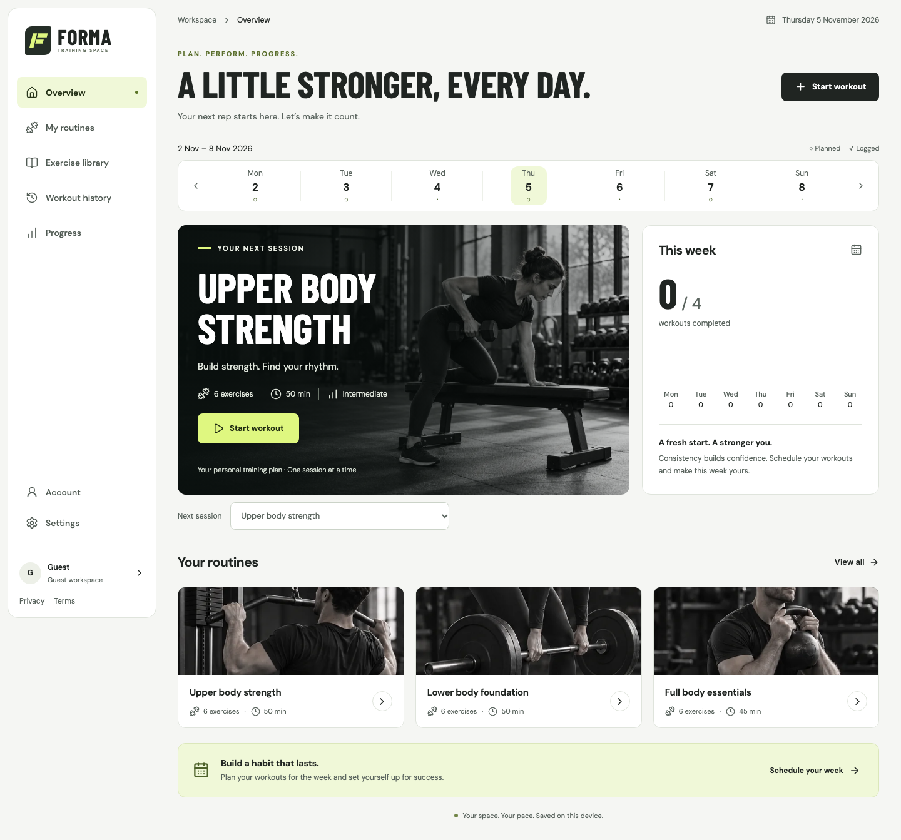

# FORMA

**Plan your training. Log every set. See your progress.**

[](https://github.com/Raoof128/forma-workout-planner/actions/workflows/ci.yml)
[](https://github.com/Raoof128/forma-workout-planner/actions/workflows/ios.yml)



_The web app's overview screen in guest mode, captured during the 5 November 2026 release review._

FORMA is a workout planner. Members build routines, log sets by weight and
reps, time or distance, and review their history and progress. It runs as a web
app at [forma.raoufabedini.dev](https://forma.raoufabedini.dev) and as a native
iPhone and Apple Watch app that is being prepared for the App Store.

[Documentation index](docs/README.md) · [Getting started](docs/getting-started.md) ·
[Architecture](docs/architecture.md) · [Security](docs/security/README.md) ·
[Contributing](CONTRIBUTING.md)

## Status

| Part                     | State on 14 November 2026                                                                                                                                                                         |
| ------------------------ | ------------------------------------------------------------------------------------------------------------------------------------------------------------------------------------------------- |
| Web app and accounts     | Live. Member accounts opened on 13 October 2026; see the [production launch record](docs/accounts/production-launch.md).                                                                          |
| Account API and database | Version 1.0 released to staging and production on 13 November 2026; see the [release record](docs/qa/app-store-1.0-2026-11-13/README.md).                                                         |
| iPhone and Watch app     | Version 1.0.0, signed and installed on the owner's devices. Not on the App Store. The [submission checklist](ios/docs/app-store-submission.md) lists the device tests and steps that remain open. |

Dated records in this repository describe what was observed on their date. They
are not a live check of the running service.

## How it is built

```text
Browser or iPhone app
  -> Cloudflare Worker (serves the web app, same-origin /api gateway)
  -> Cloudflare Access and Tunnel
  -> Fastify API -> PostgreSQL (private host, no published ports)
```

| Directory | Contents                                                                                          |
| --------- | ------------------------------------------------------------------------------------------------- |
| `src/`    | React 19 and Vite single-page app, with a browser-only guest mode and an account mode             |
| `server/` | TypeScript account API: Fastify 5, Better Auth and PostgreSQL, one validated workspace per member |
| `worker/` | Cloudflare Worker that serves the built app and forwards allowlisted `/api` requests              |
| `ops/`    | Docker Compose stack, encrypted backup and restore tooling, and monitoring for the API host       |
| `ios/`    | SwiftUI iPhone app, watchOS companion, WidgetKit extension and workout Live Activity              |
| `docs/`   | Architecture, account and security references, and dated audit and release evidence               |

Staging and production are separate stacks. Guest mode keeps working when the
API is unreachable. [Architecture](docs/architecture.md) and
[account infrastructure](docs/accounts-infrastructure.md) give the detail, and
the [native app guide](ios/README.md) covers the iPhone and Watch targets.

## How changes are checked

Every push and pull request runs the [CI workflow](.github/workflows/ci.yml):

- Lint, formatting, type checks, and the server, Worker, operations and unit
  test suites. The server tests run against a real PostgreSQL database.
- Playwright browser suites in Chromium, Firefox and WebKit, for guest mode and
  for account journeys against an isolated API.
- A secret scan over the full history (gitleaks), a dependency vulnerability
  scan (OSV), static analysis (Semgrep) and a software bill of materials.
- A documentation check for links, heading anchors and npm script names.

Pull requests that touch the native app also run the
[iOS workflow](.github/workflows/ios.yml), which builds the app and runs the
Swift package and simulator tests.

Each release leaves a dated record under [docs/qa](docs/qa/README.md) that
states what was run, what passed and what was not done. The account stack had a
red-team review before launch; its findings and residual risks are in
[docs/security](docs/security/README.md).

## Features

| Plan                                                            | Train                                               | Review and manage                            |
| --------------------------------------------------------------- | --------------------------------------------------- | -------------------------------------------- |
| Three starters and 12 additional templates                      | Weight/reps, time, and distance logging             | Editable workout history                     |
| Custom routines and exercise order                              | Persistent rest timer, hold timer and session notes | Volume, completed sets, and personal bests   |
| Weekly training schedule                                        | Exercise instructions while logging                 | Validated JSON backup and restore            |
| Searchable reviewed exercise library with source licences       | Resume an unfinished session                        | Profile, backup, and training-data settings  |
| Local guest mode or member account                              | Authenticated workspace sync across sessions        | Session revocation, MFA, import, and export  |
| Read-only or full-access coach tokens for a coaching tool or AI |                                                     | Token list, expiry, and one-click revocation |

The interface uses semantic controls, keyboard navigation, accessible dialogs,
mobile workout controls, and locally hosted fonts. See the [verification
record](docs/verification.md) for the original frontend baseline. Current
account readiness is tracked separately in
[docs/accounts/release-readiness.md](docs/accounts/release-readiness.md).
See [catalog coverage and sourcing](docs/research/runtime-catalog.md) for the
imported content, reproducible updates, and limits.

## Development

Use Node.js 24 and npm. Install the lockfile and start the Vite interface:

```sh
npm ci
npm run dev
```

For offline local storage mode, run `VITE_ACCOUNT_MODE=guest npm run dev`.
Account mode requires the API or the isolated account test harness; the Vite
development proxy is configured with `FORMA_API_TARGET` and
`FORMA_DEV_WORKER_SECRET`. Never put production credentials in Vite variables.
See [account operations](docs/accounts/operations.md) for local service and
database setup.

## Build and tests

```sh
npm run build
npm run typecheck
npm run lint
npm run docs:check
npm run test:unit
npm run test:server
npm run test:worker
npm run test:accounts
```

The real PostgreSQL server tests require `TEST_DATABASE_URL` for a disposable
database. Account browser tests use an isolated API schema and an in-memory test
email sink; they do not prove real email delivery or a Cloudflare/DigitalOcean
deployment. Browser engines must be installed with Playwright before the full
browser suite. See [testing](docs/testing.md) and the current account
[release-readiness report](docs/accounts/release-readiness.md) for the observed
limits and status.

## Privacy and security

Account-backed workout data is stored in PostgreSQL on the configured private
API host. The browser sends its Better Auth session cookie to the same-origin
Worker gateway; it never connects directly to PostgreSQL. Member identity comes
from the server-validated session, and every workspace query is scoped to that
member. Workspace API responses are not cached. Review the
[database ownership model](docs/accounts/database.md) and
[security reporting policy](SECURITY.md).

A red-team engagement on 2026-10-12 hardened the account stack and recorded
its findings, tests and residual risks in [docs/security](docs/security/README.md).
Those launch gates passed on 13 October 2026. Public accounts are live; see the
[production launch record](docs/accounts/production-launch.md) for verification
and operating limits. The owner-only [operations dashboard](https://forma-ops.raoufabedini.dev)
shows recorded service and backup checks.

Local guest mode stores data in browser `localStorage`; it is specific to the
browser profile and origin and is not encrypted. Export a backup before clearing
site data or changing browsers. The account interface supports validated import
after member confirmation, so an existing v1 backup can be transferred.

The Cloudflare Access token authenticates the Worker to the protected API
origin; it is separate from member authentication. The Worker and API share an
additional service secret. Keep both out of client assets. The production
account origin, off-host backups and actionable alerting are documented in the
dated launch record; this README is not a fresh live check.
Earlier staging evidence remains in the
[deployment record](docs/security/deployment-record.md).

## Documentation

| Document                                                | Purpose                                                         |
| ------------------------------------------------------- | --------------------------------------------------------------- |
| [Account docs](docs/accounts/README.md)                 | Account overview and references                                 |
| [Account API](docs/accounts/api.md)                     | Auth, sessions, workspace routes, and error contract            |
| [Operations](docs/accounts/operations.md)               | Environment, deployment, migrations, backup, and recovery       |
| [Database](docs/accounts/database.md)                   | Schema, ownership, revision, and migration integrity            |
| [Infrastructure](docs/accounts-infrastructure.md)       | Worker, Tunnel/Access, private-host topology, and source checks |
| [Member sync](docs/member-data-sync.md)                 | Save, retry, import/export, and conflict handling               |
| [Account readiness](docs/accounts/release-readiness.md) | Launch gates and evidence, with later releases linked           |
| [Security](docs/security/README.md)                     | Threat model, red-team findings, coverage and release verdict   |
| [Legal](docs/legal/README.md)                           | Privacy Policy and Terms of Use: sources and commitments        |
| [Sources](docs/accounts/sources.md)                     | Official source retrieval status and limits                     |
| [User guide](docs/user-guide.md)                        | Workout use and legacy browser backup guidance                  |
| [Data model](docs/data-model.md)                        | Version 2 workspace shape, v1 migration, and validation         |
| [Testing](docs/testing.md)                              | Existing frontend suite and test conventions                    |
| [Changelog](CHANGELOG.md)                               | Notable changes                                                 |
| [Security](SECURITY.md)                                 | Responsible reporting and security notes                        |

Weights use kilograms and dates use Australia/Sydney. Starter weights are
editable examples. One rep of the starter Forearm plank represents a 10-second
hold, and exercises with no external load log no weight. The web app does not
include billing, social networking, Apple Health integration, or automated
coaching. The separate native Watch companion records workouts to Apple Health
with permission; its physical-device acceptance gates remain in the native handoff.

The source is published for reading and review. All rights are reserved and no
reuse licence is granted; see [LICENSE](LICENSE). The
Barlow Condensed and DM Sans font licenses are in `public/fonts/`. Runtime
exercise illustrations and hero/routine photography are original AI-assisted
FORMA assets; generated sources, prompts and review records are preserved in
`assets/exercise-artwork`, `assets/site-visuals` and `docs/research`. This describes
their provenance and does not assert exclusive copyright over generated images.
