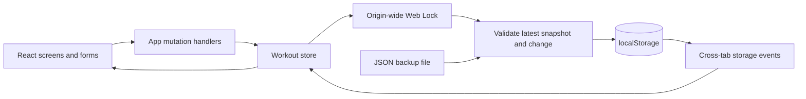

# Architecture

[Back to README](../README.md)

## Application boundary

FORMA is a static React application. Vite builds HTML, CSS, JavaScript, fonts, and images for a static host. There is no application backend, HTTP API, server database, authentication service, or server-side job. In this repository, the equivalent of backend behavior is the browser's data validation, persistence, and workout business logic.

## Responsibilities

| Area                                              | Responsibility                                                                                                                      |
| ------------------------------------------------- | ----------------------------------------------------------------------------------------------------------------------------------- |
| `src/main.jsx`                                    | Mount React and the render-error boundary                                                                                           |
| `src/App.jsx`                                     | Screen composition and routine/session/profile/schedule mutations                                                                   |
| `src/persistence.js`                              | Framework-independent repository: locking, validation before write, revisions, restore conflicts, preservation, and temporary state |
| `src/hooks/useWorkoutStore.js`                    | React subscription, persistence status, pending writes, and cross-tab updates                                                       |
| `src/storage.js`                                  | Workspace validation, initialization, browser storage reads, and downloads                                                          |
| `src/data.js`                                     | Exercise catalog, starter routines, Sydney dates, and training calculations                                                         |
| `src/components/Workout.jsx`                      | Session entry and rest-timer transitions                                                                                            |
| `src/components/Preferences.jsx` / `Recovery.jsx` | Import/export and recovery flows                                                                                                    |
| `src/hooks/useNavigation.js`                      | Hash navigation, document titles, and heading focus                                                                                 |
| `tests/`                                          | Real-browser workflow, data-integrity, accessibility, and layout checks                                                             |

## Write model

Mutations operate on the latest saved workspace inside the shared `forma-store-write` Web Lock. The changed workspace is validated before persistence. Task boundaries inside the lock let browser-local storage snapshots refresh before reading and checkpoint writes before lock release. This prevents unrelated edits from two tabs from overwriting one another with stale snapshots. Routine, history, profile, and schedule edits also compare the original record so a stale editor can report a conflict.

A browser storage event reloads changes from another tab. Active-session operations identify the intended session and apply field-level changes to the current state. Pending writes are counted and trigger an unload warning. Temporary mode preserves an in-memory workspace, advances revisions, and allows export when persistence cannot be used. Lock API absence or rejection selects this mode without retrying a failed business mutation. Repository updates work on a cloned draft; a rejected mutation cannot partially alter the acknowledged snapshot. React subscribes through `useSyncExternalStore`.

Recovery and restore preserve original data before replacement and reject stale confirmations. Settings restore checks the revision; corrupt-data recovery compares the exact raw original. Recovery keys combine a timestamp and random ID. If temporary edits exist, both the saved original and the in-memory original are preserved before replacement. See [data model](data-model.md) for the storage contract and the audit record for tested failure paths.

## Trust boundaries and privacy

Treat `localStorage` and imported JSON as untrusted input. They pass through the same nested Zod validation. Exercise IDs must refer to the built-in catalog; record IDs must be unique within their collections. React renders user-entered names and notes as text rather than HTML.

Origin-local storage is a convenience persistence mechanism, not authentication or an encryption boundary. All scripts running on the same origin share access. Host the app on an origin you control, serve it over HTTPS, and avoid injecting untrusted scripts. There are no service secrets to put in the browser bundle.

## Deployment and future changes

Hash routes allow static hosting without server-side route handlers. The current asset paths assume deployment at an origin's root; a subdirectory deployment requires coordinated asset/base-path changes. Changing origins requires manual export/import of data.

Adding accounts or sync would require a separate product and architecture decision: user identity, authorization, a remote schema, synchronization/conflict rules, and a migration path for local workspaces. None of those services is implied by the current browser-local design.
