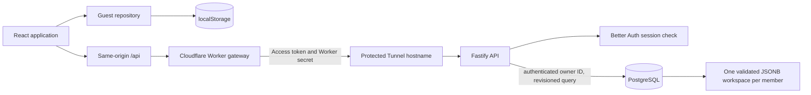

# Architecture

[Back to README](../README.md)

FORMA has two workspace modes. Guest mode stores a validated version 2
workspace in the browser. Account mode authenticates with Better Auth and uses
PostgreSQL as the authoritative store. The account implementation is designed
for Cloudflare Workers static assets and same-origin API routing to a private
Node.js API; configured public domains and a live cloud deployment are not
included in this repository state.

The Access service token and Worker shared secret authenticate the Worker to
the origin. They do not identify a member. The API resolves each member from a
Better Auth session cookie, then scopes database access to that user. The
browser never connects directly to PostgreSQL and never chooses the workspace
owner.

## Responsibilities

| Area                                                            | Responsibility                                                                                |
| --------------------------------------------------------------- | --------------------------------------------------------------------------------------------- |
| `src/App.jsx` and `src/components/`                             | Workout screens, account interface, and mutation handlers.                                    |
| `src/storage.js`                                                | Version 1 validation, guest initialization, legacy backup parsing, and download helpers.      |
| `src/persistence.js`                                            | Guest-mode persistence, Web Lock coordination, revision checks, recovery, and temporary mode. |
| `src/account/AccountProvider.jsx`                               | Browser account/session state and Better Auth actions.                                        |
| `src/account/cloudRepository.js`                                | Authenticated workspace reads, optimistic writes, retries, conflicts, and import/export.      |
| `server/auth.ts` and `server/app.ts`                            | Self-hosted Better Auth and HTTP authentication/session boundaries.                           |
| `server/workspace.ts` and `server/workspaceRoutes.ts`           | Validated member workspace transactions, revision conflicts, and export.                      |
| `server/migrations/`                                            | Better Auth and workspace PostgreSQL schema.                                                  |
| `worker/index.ts` and `wrangler.jsonc`                          | Fixed-origin Worker API gateway and static asset routing.                                     |
| `ops/`                                                          | Private-host Compose services, database role setup, migrations, and backup/restore scripts.   |
| `server/tests/`, `worker/tests/`, and `tests/accounts*.spec.js` | Real PostgreSQL integration, gateway behavior, and account UI browser checks.                 |

## Member workspace writes

The workspace preserves FORMA's version 2 JSON shape while PostgreSQL owns the
member key, integer revision, and monotonic `updatedAt`. The client sends
`expectedRevision` and an operation ID. The API locks the member's row,
validates the full payload, and either commits the next revision or returns a
409 response with the latest member state. A retry with the same operation ID
and normalized payload reconstructs the original acknowledgement. Operations
are retained for at most 1,000 per member and 30 days; an aged-out retry cannot
apply because its expected revision is stale. See the
[database model](accounts/database.md) and [API reference](accounts/api.md).

The legacy browser store remains available as guest mode. Account import
requires explicit confirmation and uses the same validation and revisioned PUT
as other writes. Switching from guest mode to an account does not silently
copy browser data.

## Guest mode and recovery

Guest mode treats `localStorage` and imported JSON as untrusted. The nested Zod
schema validates before use. Exercise IDs must refer to the built-in catalog;
record IDs must be unique within their collections. User-entered text is
rendered as text, not HTML. Browser storage is not authentication or an
encryption boundary; scripts on the same origin may access it.

Guest writes use the origin-wide `forma-store-write` Web Lock where available.
Storage events refresh other same-origin tabs. Temporary mode keeps edits in
memory and warns the member when browser persistence is unavailable. Account
writes instead use server revisions and API conflict recovery.

## Deployment and operational boundaries

The deployment baseline is Worker static assets and same-origin API routes,
then a fixed HTTPS API origin protected by Cloudflare Access and Tunnel,
reaching a private Fastify host and private PostgreSQL. The Worker never accepts
an arbitrary upstream URL. The origin still validates member sessions and
ownership. A VPC-only host needs outbound connectivity for the Tunnel, updates,
email, and approved backup/deployment traffic. Cloudflare Workers VPC is beta
and is not a required production dependency.

The repository does not establish a live origin, firewall, Tunnel, Access
policy, database backup schedule, or restore RTO. Use the
[operations guide](accounts/operations.md),
[infrastructure reference](accounts-infrastructure.md), and
[release-readiness report](accounts/release-readiness.md) for the actual
configuration state and open owner tasks.
