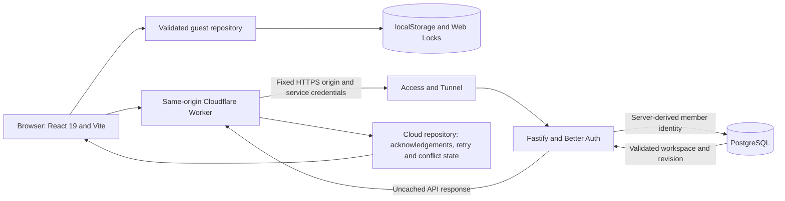

# FORMA runtime, performance and quality audit

Audit dates: **23–26 October 2026**, Australia/Sydney. Baseline:
`678b48325189f83beb942bc6759e7c519eb26b19`. Development branch:
`audit/runtime-quality-2026-10-23`. The initial working tree was clean.

## Assessment

The file audit and scoped corrections are complete. Every applicable source
file was examined; all configured browser cases have passing coverage after
one documented timeout investigation and unchanged profile replay. The final
unit, API, Worker, operations, static, dependency and production-build checks
pass. The code is ready for deployment review, with cold mobile loading and
current hosted/physical-device checks explicitly outstanding. Nothing was
deployed.

The audit found and corrected failures that could discard cloud-save recovery
state, terminate the API after an idle database connection failed, leak a late
screen wake lock, crash a workout during a cross-tab edit, or present the wrong
backup for import. It also corrected Sydney week/date calculations, unilateral
strength estimates, overrange per-side prescriptions and keyboard focus after
moving an imported routine.

The main retained performance changes aggregate Progress records once, avoid
re-normalizing unchanged catalog search metadata, hash a captured guest backup
once per workspace mount, and reduce established workspace reads from four SQL
statements to one. Authentication and validation remain on the request path.
No library was added; narrow transitive and pinned runtime security patches were applied.
There are no schema, migration, stored exercise-ID, asset-quality or CSS changes. No production action, commit, push or deployment was performed.

## Scope and completeness

All **1,453 baseline tracked files** are reconciled exactly once in
[FILE_AUDIT.md](FILE_AUDIT.md): **550 applicable human-maintained files reviewed**
and **903 generated, imported or binary files explicitly inventoried and
validated**. Ten new implementation/test files and these six audit documents
bring the final ledger to **1,469 rows**. There are no unexamined applicable
baseline files or missing inventory paths.

The six required project documents were read in full before code changes:
`AGENT.md`, `CHANGELOG.md`, `docs/data-model.md`, `docs/accounts/api.md`,
`docs/member-data-sync.md` and `docs/security/README.md`. Relevant architecture,
testing, operational, security and research documentation was also inspected.
Review was divided by file ownership, then reconciled and independently checked
across the changed state, UI, API and gateway boundaries.

| Area | Baseline files | Applicable files reviewed | Explicit exclusions validated |
| --- | ---: | ---: | ---: |
| Root configuration and assigned browser tests | 45 | 44 | 1 |
| Application state, storage and assigned browser tests | 24 | 24 | 0 |
| Components, CSS and assigned browser tests | 39 | 39 | 0 |
| API, Worker and operations | 57 | 57 | 0 |
| Catalog, scripts, assets and research | 1,017 | 263 | 754 |
| Other documentation, unit tests and historical evidence | 271 | 123 | 148 |
| **Total** | **1,453** | **550** | **903** |

Mixed research files were not excluded merely because they contain JSON.
Authored decisions in all 202 atlas manifests, historical control matrices and
other maintained records were read; generated/imported fields were checked
structurally. Duplicate authored values were read once with mappings to every
source file retained. Complete image decoding, video probing and SVG rebuilding
are integrity checks, not fresh medical, legal or frame-by-frame artwork approval.

## Verified architecture

`src/main.jsx` mounts React StrictMode, the error boundary and account provider.
`AccountProvider` resolves the cookie-backed session before exposing a private
workspace; explicit guest builds initialize guest mode. `App.jsx` composes the
hash routes: Overview, routines, library, workout, history, progress, settings,
account and legal pages. Eager imports and catalog metadata dominate initial
JavaScript. Locally hosted fonts and overview WebP backgrounds complete the
initial visual loading path.

`useWorkoutStore` selects the guest or member-bound cloud repository and
subscribes with `useSyncExternalStore`. Guest persistence validates untrusted
local storage and backups, coordinates writes with Web Locks where available,
and handles cross-tab storage events. Account mode reads the private workspace,
refreshes on focus and at a 30-second interval, and sends revisioned writes.
Session refresh has its own 60-second interval and foreground/BroadcastChannel
checks. Effect cleanup and disposal boundaries were inspected.

The Worker uses fixed origins and explicit path/method allowlists. It replaces
caller-supplied service headers, separates browser cookies from bearer-coach
routes, enforces origin/body/timeout limits, preserves separate Set-Cookie
values and returns API responses with `no-store`. Access credentials identify
the gateway to the origin; they do not identify a member.

Fastify validates the gateway boundary and request, and Better Auth resolves
the member from the session. Workspace queries use that server-derived owner;
the browser's opaque member reference is a consistency guard, not authority to
choose another owner. PostgreSQL stores one validated version-2 JSONB workspace
per member. Writes retain row locking, expected-revision comparison and
idempotent operation acknowledgements. Existing reads now use one validated
owner-filtered SELECT; first creation remains transactional. Coach summaries
and scoped edits use separate token permissions and the same data contracts.

The API container pins Node 26 and runs as UID 10001; CI/local tooling can use
Node 24 under the declared engine constraint. Ops scripts define isolated
Compose projects, private database access, migrations, backup/restore and
monitoring. Their source and fixture tests were reviewed. This audit did not
exercise today's hosted Access, Tunnel, email, storage or production stacks.

## Findings and disposition

### Implemented application corrections

| ID | Severity | File and root cause | Impact | Action | Verification |
| --- | --- | --- | --- | --- | --- |
| ST-01 | High | `src/account/cloudRepository.js`: a GET started before a write could later replace retry/conflict state or downgrade an acknowledged write. | Unsynced edits lose their recovery/retry path; incorrect sync status. | Fixed with write epochs and refresh guards; authentication/account-change failures still clear private data. | Six original defect cases failed before correction; final race/authentication cases and related repository suite passed (58 combined cases). |
| ST-02 | Medium | `src/account/cloudRepository.js`: commit guarded the displayed conflict status instead of the retained conflict payload during explicit reload. | A new edit could start before conflict resolution completed. | Block edits while conflict data remains, regardless of display status. | Deferred reload regression rejects the intervening edit, then permits saving after successful reload. |
| ST-03 | Medium | `src/App.jsx`: unchanged legacy backup fingerprint was recalculated on every workspace render. | Repeated synchronous work proportional to backup size. | Compute once per workspace mount with the existing immutable snapshot. | Source invariant and existing migration tests checked; old helper timings excluded because runtime-version metadata was not independently confirmed. No browser-latency claim. |
| ST-04 / UI-05 | Medium | `src/routineProgramming.js`, `src/App.jsx`, `src/components/Routines.jsx`: routine schema allowed a per-side target above 50, but the logger stores at most 100 combined reps. | A saved routine could construct an invalid workout and fail to start. | Shared editor/start guard gives corrective guidance. Existing backups remain readable; no clamp, migration or schema change. | Three unit cases and targeted browser regression pass: saved 60 remains editable, range 40–60 is rejected, and 40–50 starts at 40 per side / 80 total. |
| UI-01 | Medium | `src/components/Workout.jsx`: asynchronous wake-lock grants outlived pause/unmount; pending requests were not deduplicated. | Screen could remain awake after a hold ended; duplicate locks. | Effect owns the request, pending flag and lock; late grants release themselves. | Two Chromium regressions pass for pause/resume, visibility events and navigation before grant. Original runs showed zero releases / three requests where one was expected. |
| UI-02 | Medium | `src/components/Insights.jsx`: Progress rescanned history for each of 1,418 load/reps catalog records. | Heavy history caused unnecessary render-time CPU and allocation. | New `src/progressSummary.js` aggregates completed sets once, retaining catalog order and saved identities. | Output parity and three semantic unit cases pass; isolated 1,000-session benchmark median 91.67 ms → 0.5024 ms. This is helper CPU timing, not field INP; browser comparison is separate. |
| UI-03 | Medium | `src/components/Account.jsx`: device timezone controlled dates and Monday boundaries despite the Sydney contract. | Account weekly totals and session dates differed from training views. | Reuse Sydney timezone/date/week helpers; retain future-session exclusion. | Los Angeles-device regression at Sydney Monday now shows 1/4 workouts and the correct Monday date; original showed 2/4 and Sunday. |
| UI-04 | Medium | `src/components/Account.jsx`: asynchronous file reads lacked request identity and left the previous review actionable. | An older backup/error could replace the latest selection or restore a cancelled review. | Sequence guard on selection/cancel/local review; clear prior draft and acknowledgement immediately. | Two account-mode regressions pass for delayed old success/error and cancellation. Required import acknowledgement and cloud export remain intact. |
| UI-06 | Medium | `src/components/Workout.jsx`: replacement-picker title dereferenced a target removed by another tab. | React error boundary interrupted active workout use. | Derive the current target, render only while it exists and clear obsolete picker state. | Valid baseline production replay reproduced the TypeError; final two-tab test closes the picker and preserves the remaining workout. Earlier invalid fixture is explicitly excluded from evidence. |
| UI-07 | Medium | `src/components/RoutineCardOrder.jsx`: imported routine ID was interpolated into a CSS selector without escaping. | Valid punctuation-bearing IDs broke focus restoration after reordering. | Escape the selector value using `CSS.escape`, preserving IDs and order. | Baseline replay failed focus restoration; final test verifies requested order, restored trigger focus and no page errors. |
| UI-08 | Low | `src/components/Account.jsx`: Privacy export handler set feedback rendered only in another section. | Export failures had no visible explanation. | Render existing success/error elements in Privacy. | Account regression shows visible export error; failed sign-out still hides private data through existing AccountProvider behavior. Sign-out itself was verified acceptable. |
| SV-01 | Medium | `server/coachTokens.ts`: coach strength estimates used combined reps for unilateral sets. | Incorrect 1RM compared with member Progress; an 8-left/8-right set was excluded as 16 reps. | Use shared `sideReps` for strength while retaining combined-rep volume. | Baseline red case now reports 38 kg for 30 kg × 8 per side; seven coach summary cases and final server suite pass. |
| SV-02 | Medium | `server/coachTokens.ts`: weekly coach grouping used UTC weekday boundaries. | Sydney Monday sessions appeared in the previous week. | Derive the shared Sydney date key before calendar grouping. | Standard-time and daylight-time midnight boundary regressions pass; compiled Node 26 image passes. Initial type mismatch was corrected before final build. |
| SV-03 | Low | `worker/index.ts`: response-header allowlist omitted documented `WWW-Authenticate`. | Bearer clients lost the API authentication challenge. | Allow only this additional response header; keep credential separation and `no-store`. | Red/green 401/403 header fixture verifies challenge, adjacent internal-header stripping and cache behavior; Worker 27/27 pass. |
| SV-04 | Medium | `server/workspace.ts`: established GETs repeated transaction, starter construction and conflict-ignored insert work. | Avoidable database round trips and request CPU. | One owner-filtered parameterized SELECT plus strict validation for existing rows; retain transactional creation and all write/CAS locks. | Read-only regression and 20 concurrent mixed-owner first reads pass; existing workspace SQL 4→1, full authenticated GET 6→3. Final matched Node 26.12.1 local HTTP p50: empty 3.970→3.088 ms; 100 sessions 22.138→20.918 ms. Large-response tails vary; no production-latency claim. |
| SV-05 | High | `server/index.ts`: idle `pg.Pool` errors had no listener and terminated Node. | A transient database disconnect crashed the API. | Register a constant, redacted error handler; allow pool replacement without suppressing startup/query failures. | Real backend termination fails baseline and passes after: process survives, emits only the expected message, handles an authenticated-route rejection and obtains a replacement PG client. Server 67/67 and built-image smoke pass. |
| CAT-01 | Low | `src/catalog/search.js`: each match repeated static metadata normalization and query tokenization, even for blank search. | Modest avoidable filtering/picker CPU. | Previous-query token cache and per-object WeakMap metadata cache, with mutation invalidation and blank-query shortcut. | Three complete-result parity/mutation/isolation cases pass; 30 alternating samples of full catalog filters show pushup median 3.503→1.164 ms. Microbenchmark only; no claim it dominates page startup. |

### Dependency advisory correction

| ID | Severity | File and root cause | Impact | Action | Verification |
| --- | --- | --- | --- | --- | --- |
| DEP-01 | Medium | `package-lock.json`: four transitive `fast-uri` records were in newly disclosed vulnerable ranges. | URI normalization/canonicalization defects in a production dependency; no concrete FORMA exploit path was established. | Patch three records from 3.1.8 to 3.1.9 and one from 4.2.2 to 4.2.3. Keep every direct dependency pin unchanged; the separate tooling override is recorded below. | The 23 October morning audit was clear; advisories were published on 23 October at 21:36–21:41 UTC (24 October morning Sydney) and the 26 October check correctly failed. The exact four-record candidate passes advisory scanning; final install, server/Worker and container revalidation are recorded in the regression report. |
| DEP-02 | High | `package.json`, `package-lock.json`: Miniflare exactly pinned Undici 7.29.1 in the development toolchain. | Known HTTP-client advisories; no concrete FORMA application exploit established. | Add an override scoped to that exact Miniflare version, selecting Undici 7.30.1. Keep Wrangler/Miniflare and all direct library pins. | Clean install and full npm audit pass; actual Wrangler dry-run and local Miniflare smoke validate the tool boundary. |
| DEP-03 | High | `ops/Dockerfile`: Node 26.12.0 embeds affected Undici 8.11.2, invisible to npm's package scan. | The API's built-in fetch implementation is affected; its identified outbound call is to the fixed Cloudflare mail endpoint, with no attacker-selected URL established. | Pin both stages to official stable Node 26.12.1 and its exact image digest, containing Undici 8.12.2. | Actual container versions verified; final Node 26 server tests, image build and smoke are recorded in the regression report. The diagnostic host's older Node runtime is not claimed patched. |

## Documentation and test corrections

| ID | Severity | File and root cause | Impact | Action | Verification |
| --- | --- | --- | --- | --- | --- |
| DOC-01 | Medium | `docs/member-data-sync.md`, `docs/architecture.md`, `docs/security/authorisation.md`, `docs/security/database-security.md`, README/contributor/user guides: v1 and unknown-key handling descriptions drifted from implementation. | Incorrect integration/import/ownership guidance. | Describe v2 storage, v1 migration and strict direct-API rejection; retain browser normalization distinction. | Compared storage validator, workspace API, migration 0004 and data model; local doc links pass. |
| DOC-02 | Medium | `docs/accounts/api.md`, `docs/security/authentication.md`: old Better Auth pin, incomplete lifetimes and stale session-revocation contract. | Clients/operators could use the wrong reauthentication flow. | Document pin 1.7.11, sliding/absolute lifetime, password/TOTP step-up and revoke-all exception. | Cross-checked pinned manifest and current auth/session routes. No authentication control weakened. |
| DOC-03 | Medium | `README.md`, `SECURITY.md`, current account/infrastructure/deployment/security guides and indexes: pre-launch statements contradicted configured domains and later receipts. | Wrong operational assumptions, superseded hostname creation guidance and misleading readiness labels. | Correct current configuration references and explicitly date old verdicts; preserve historical evidence. | Compared Wrangler/ops configuration and dated launch records. No present-day remote health, certification or deployment is claimed. |
| DOC-04 | High | `docs/qa/workout-coach/README.md`: called an old API image safe even though it rejects already-saved `fillSets`/`sides`; frontend rollback cannot remove stored fields. | Following rollback advice could break member workspace access. | Remove unsafe assurance; prefer forward correction and require saved-data/schema/catalog compatibility. | Confirmed strict validation and saved-field semantics. No rollback or data stripping performed. |
| DOC-04b | Medium | `docs/accounts-infrastructure.md`, `docs/accounts/operations.md`, `docs/deployment.md`, `docs/security/incident-response.md`: mixed manual and signed backup procedures, implicit Compose scope. | Recovery or incident commands could target the wrong environment or verify the wrong archive format. | Separate signed-manifest recovery, use explicit project/env selection, put staging verification before production. | Compared operations scripts and Compose configuration; external operations were not executed. |
| DOC-07 | Low | `README.md`, `docs/getting-started.md`, `docs/user-guide.md`, `docs/security/privacy.md`: stale counts/runtime/provider/token-scope and hold-persistence text. | Misleading feature, recovery and maintenance expectations. | Align descriptions with current source and published policy; describe hold countdown as transient. | Source comparison with Docker pin, timer state, coach scope and legal content. |
| DOC-08 | Low | `unit/storage.test.js`: legacy-v1 test used the current v2 factory without overriding version. | Migration coverage silently stopped exercising v1 input. | Set fixture version 1 and assert migrated version 2. | Existing storage file passes 9/9, zero skips/failures. |
| DOC-09 | Low | `docs/security/security-coverage-matrix.csv`: later coach control reused TOTP's API2-05 identifier. | Ambiguous control traceability. | Rename coach row API2-07; label historical matrix scope in security index. | All 63 control IDs and 253 ASVS IDs unique; every row read; no linked coach API2-05 reference found elsewhere. |
| CAT-02 | Low | `docs/research/runtime-catalog.md`, `docs/research/catalog-quality.md`, `docs/research/original-art/README.md`, `docs/research/exercise-videos.md`: current snapshots retained obsolete counts/release wording. | Misleading catalog/media maintenance guidance. | Add dated current snapshots and preserve older receipts in historical context. | Source confirms 1,411 selectable / 1,711 compatible / 1,661 originally published IDs; all logging decisions validated. |
| CAT-03 | Low | `docs/research/original-art/authored-guide-replacements.json`: scope still said 16 after a seventeenth entry was appended. | Incomplete provenance summary. | Clarify 16 initial entries plus the later seventeenth; preserve records and runtime data. | JSON parses and 17 distinct replacement records are present. |

## Deferred or verified acceptable

| ID | Severity | File and root cause | Impact | Action | Verification |
| --- | --- | --- | --- | --- | --- |
| ST-05 | Low | `tests/persistence.spec.js`, `tests/security-release.spec.js`, `tests/regressions.spec.js`, `tests/workflows.spec.js`: fixtures hardcode the documented local origin. | Alternate-port test portability; no user-facing runtime defect. | Deferred; run supported configured ports. Existing scratch-copy workaround remains documented. | Full source review; final execution results belong to runtime report. |
| ST-06 | Medium | `src/App.jsx`: eagerly loaded training UI contributes to a large entry bundle. | Cold-start cost remains; mobile-throttled LCP target needs further work. | Reject naive lazy split. Follow-up should reduce eager metadata or establish reliable core-chunk availability before deferring training screens. | Scratch entry gzip fell 29%, but paired first Routines navigation worsened from median 190 ms to 1,443 ms and offline first navigation hit recovery. Candidate never entered final source. |
| RT-OBS-01 | Low | `src/components/Workout.jsx`: existing 250 ms timer updates commit the workout root while open. | Potential future render-locality improvement; measured input response did not establish visible lag. | Verified acceptable for this patch; preserve timers/motion and defer speculative component restructuring. | Baseline production hook observed 4 idle-workout commits / 1.1 s, 5 running-rest commits / 1.1 s and 18 commits over five weight fills plus 300 ms. Lab input median was 24 ms; this is not field INP. Final matched metrics belong to runtime report. |
| RT-OBS-03 | Low | `src/components/Library.jsx`, `src/components/UI.jsx`: repeated-use profiling showed +1 DOM-counter node per search cycle in both versions. | Potential retention signal requiring isolation. | Verified as browser/automation input-editing behavior; no application patch justified. | Bare native input reproduces 9→29→49 nodes without FORMA; programmatic input/guide/idle controls stay flat, connected app DOM and listeners stay constant, detached-DOM queries report no trees. Short-run limits remain explicit. |
| DOC-ACCEPT-01 | Low | Historical QA JSON, security CSVs, screenshots, videos, logs and receipts retain old results and known branch gaps. | Readers could mistake archived PASS labels for current certification. | Preserve dated evidence; new audit results are separate. Generated/binary artifacts remain explicitly excluded from manual source review and individually validated. | Authored records reviewed, control/summary/crosswalk consistency checked, binaries decoded/probed, public keys parsed, synthetic previews checked. No blanket historical re-certification. |

The account development matrix initially contained one 30-second global test
deadline failure. Trace analysis, unchanged baseline/current full-flow
comparisons, and a complete 22-case profile replay at the original budget found
no application regression. All configured cases now have passing coverage;
the initial failure and exact replays remain explicit in the regression report.

## Evidence and reporting boundaries

Sector sources: `state-findings.md`, `ui-findings.md`, `server-findings.md`, `catalog-findings.md`, `docs-tests-findings.md`, plus the runtime baseline/profile receipts. The root's final dependency check additionally established DEP-01–03 above. Baseline and candidate measurement failures or invalid fixtures were retained and explicitly superseded, not counted as passing evidence.

Completed gates include unit 134/134, server 67/67, Worker 27/27, operations
6 Python + 8 Node, static checks, frontend/server builds, final-image smoke
and zero reported npm vulnerabilities. Catalog checks include complete media
mapping and byte-identical generator reproduction. These results do not
establish present-day Cloudflare/Access/mail/R2/restore health, sustained
production capacity, fresh clinical/rights review, or full historical artifact
pixel/frame review. Exact browser outcomes, visual checks and evidence limits
are recorded in [REGRESSION_TESTS.md](REGRESSION_TESTS.md).

## Performance and visual preservation

Matched Chromium production-build measurements show populated Progress
navigation **91→35 ms median** on desktop and **344→48 ms** at 390px/4× CPU,
using the same asserted 1,000-session fixture and five samples per variant.
These are lab navigation proxies, not field INP. The final Node 26.12.1 local
HTTP comparison reduces authenticated queries **6→3**; empty-response p50 is
**3.970→3.088 ms** and 100-session p50 **22.138→20.918 ms**, with variable tails.

Cold throttled LCP is **5,056→5,088 ms**, essentially unchanged and above the
2.5-second target. Initial JS gzip body grows by 530 bytes (0.095%); no startup
payload gain is claimed. CLS is zero in all 12 loads per variant. Input timing
ranges overlap; no weight-input speedup is claimed.

The final 75 guest screenshot pairs have identical dimensions: 68 match exactly
and seven have only 10–48 pixels of one-channel-level raster rounding. Eight
Library pairs were recaptured with all lazy images decoded, retaining the
premature originals. Four extra account pairs verify the intentional Sydney
corrections. Motion and reduced-motion behavior remain; full-resolution
comparisons and runtime caveats are supplied separately.

The attempted training-route split was rejected. It reduced entry gzip size
by 29%, but first training navigation rose from 190ms to 1,443ms median under
the same throttle and no longer worked after loading Overview then going
offline. No experimental split was retained. Initial payload remains a
documented opportunity requiring an approach that preserves first-use/offline
behavior.

The shared workspace schema, stored measurements, exercise aliases, legacy
plank units, motion system, fonts, media and stylesheets are preserved. Intentional
UI differences are corrected dates/counts, explicit validation/error feedback
and closing a picker whose target has disappeared. See
[PERFORMANCE_RESULTS.md](PERFORMANCE_RESULTS.md) and
[REGRESSION_TESTS.md](REGRESSION_TESTS.md) for measured and visual evidence.

## Security and privacy verification

Package advisory scans were extended to development tooling and the Node-bundled
HTTP client; npm audit alone did not cover the latter. No new private-response
cache, browser bearer-token storage, query interpolation,
owner selection or weaker authentication path was introduced. The cloud race
guard deliberately continues to clear private data on a late unauthorized or
account-changed response. The pool recovery message contains no raw error,
connection string, request body or account data. The Worker header change adds
only the documented bearer challenge and preserves adjacent header rejection.

Real PostgreSQL integration tests cover separate synthetic members, read/write/
export ownership, strict unknown-field rejection, session expiry, MFA and
step-up, replay, conflicts and durable lockouts. Local account browser tests
exercise the same-origin API through the documented harness. The production
dependency advisory check is recorded with its timestamp and scope; it is not
a proof of overall security or a fresh ASVS certification.

## Residual risks and boundaries

- Cold loading under the mobile lab throttle remains a performance concern.
  Bundle-size reductions must account for first training use and offline behavior.
- Workout's 250ms clock causes root commits while mounted. Measured interaction
  responsiveness and cleanup are reported; no speculative timer refactor was
  made without evidence of a user-visible bottleneck.
- Some historical browser tests hardcode the documented development origin,
  limiting alternate-port portability. Default supported matrix ports were used.
- Whole-workspace validation and serialization still scale with saved history.
  Query reduction does not eliminate that payload cost or establish production
  capacity at the maximum schema limits.
- Linux headless browsers and mobile emulation do not substitute for physical
  iOS/Android keyboards, battery behavior, GPU smoothness or real-user telemetry.
  No field INP/p75, production API p95 or production load-test result is claimed.
- Live deployment readiness requires current hosted service checks and release
  review. Dated launch/backup/security receipts remain historical; no live data,
  secret, external account, remote infrastructure or production database changed.

## Deliverables and reproducibility

- [File inventory](FILE_AUDIT.md)
- [Baseline and methodology](PERFORMANCE_BASELINE.md)
- [Measured results](PERFORMANCE_RESULTS.md)
- [Regression evidence and limitations](REGRESSION_TESTS.md)
- [Optimisation decisions](OPTIMISATION_DECISIONS.md)

The accompanying review bundle contains the exact patch from the baseline,
machine-readable inventory, selected raw measurements and test receipts. The
separate visual bundle contains all before/after screenshots and comparisons. Large temporary profiles, generated
asset rebuilds and browser traces remain audit scratch outputs, not repository
source changes. `AGENT.md` and `CHANGELOG.md` record this local audit and the
remaining release gates.
