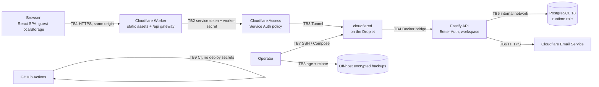

# Threat model

[Back to security overview](README.md)

STRIDE threat model for the self-hosted account architecture. It describes the
code on `security/red-team-hardening`; deployed infrastructure was not
inspected (see [standards and scope](standards-and-scope.md)).

## Architecture and trust boundaries

| Boundary | What crosses it                                   | Primary controls                                                                                                                           |
| -------- | ------------------------------------------------- | ------------------------------------------------------------------------------------------------------------------------------------------ |
| TB1      | Cookies, member reference header, workspace JSON  | Exact-origin checks, `Sec-Fetch-Site`, route and method allowlist, body caps, header allowlists, CSP/HSTS, no-store                        |
| TB2–TB3  | Proxied API requests                              | Access Service Auth (strict) with one service token, Tunnel-only ingress, worker shared secret checked again by the API                    |
| TB4      | Requests to the API                               | Deny-by-default gateway check, Origin check, encoded-path rejection, member session and member reference on every member route             |
| TB5      | SQL                                               | Parameterised queries, runtime role with DML only on eight tables, statement timeouts, foreign keys with cascade, owner-keyed primary keys |
| TB6      | Transactional email                               | Fixed provider endpoint, per-recipient budget, links validated to the app origin                                                           |
| TB7–TB8  | Host administration, backups                      | Documented in [Droplet hardening](droplet-hardening.md) and [database security](database-security.md); not verified live                   |
| TB9      | Source, dependencies                              | Pinned actions and images, read-only token, secret scanning, OSV, Semgrep, SBOM                                                            |
| Legacy   | Guest `localStorage` data into a member workspace | Shared schema validation with aggregate bounds, explicit review and export-before-import, import pinned to the reviewed revision           |

## Assets

Member identities and email addresses; password hashes (scrypt, Better Auth);
session tokens; TOTP secrets and recovery codes (encrypted by Better Auth);
reset, verification, change-email and deletion tokens; workout records,
routines, history, goals and preferences; backup files; the database
credentials, `AUTH_SECRET`, `ORIGIN_SHARED_SECRET`, Access service token,
Tunnel token and Cloudflare Email token; CI configuration; logs.

## Threat register

Likelihood and impact are qualitative (L, M, H). Status refers to the hardening
branch.

| ID   | STRIDE | Attacker and entry                                                    | Asset                | Expected control                                                            | Test                                            | Residual |
| ---- | ------ | --------------------------------------------------------------------- | -------------------- | --------------------------------------------------------------------------- | ----------------------------------------------- | -------- |
| T-01 | S      | Anonymous; credential stuffing on sign-in from many IPs               | Accounts             | Per-IP limit plus per-account cap (10/15 min, hard lock at 100)             | RT-04, RT-04b, RT-13                            | L        |
| T-02 | S      | Anonymous; account enumeration via sign-up, reset, resend, timing     | Member emails        | Uniform responses; unverified state hidden                                  | `auth.test.ts`, engagement probes               | L        |
| T-03 | E      | Member A; read or write member B's workspace by ID or header          | Workout data         | Owner from session only; HMAC member reference; owner-keyed rows            | `security.test.ts`, `accounts-security.spec.js` | L        |
| T-04 | S/E    | Stolen session; keep access after password change                     | Sessions             | Server forces revocation of other sessions                                  | RT-05                                           | L        |
| T-05 | E      | Stolen session plus inbox access; mint a fresh session via email link | MFA, step-up         | Sessions from email links are deleted and withheld                          | RT-10                                           | L        |
| T-06 | S      | Stolen cookie used for months                                         | Sessions             | 30-day absolute lifetime, 7-day sliding expiry                              | RT-11                                           | L        |
| T-07 | T      | Phishing via open redirect on token links                             | Members              | Redirect parameters and `Location` limited to the app origin                | RT-02, RT-12, EDGE redirect tests               | L        |
| T-08 | E      | Direct-origin caller (misrouted Tunnel, internal pivot)               | API                  | Worker secret required on every path; encoded paths refused                 | RT-01                                           | L        |
| T-09 | I      | Leaked Access service token                                           | API reachability     | Worker secret still required; member session still required                 | `security.test.ts`, RT-01                       | M        |
| T-10 | D      | Member uploads crafted 20 MiB workspaces                              | API availability     | Aggregate bounds before parsing, single validation, per-member write budget | FE-01, RT-07, EDGE-01                           | L        |
| T-11 | D      | Anonymous large bodies on auth routes                                 | API availability     | 64 KiB cap at the Worker; auth before parsing on workspace PUT              | EDGE-01                                         | L        |
| T-12 | D      | Mail flooding of a victim                                             | Mailbox, email quota | Per-recipient, per-kind budget of 5 per hour                                | RT-06                                           | L        |
| T-13 | T      | Malicious backup or legacy import                                     | Workspace integrity  | Strict shared schema, unknown keys stripped, bounds, review gate            | `security-release.test.js`, FE-01               | L        |
| T-14 | T      | Restore or import over newer cloud work from another device           | Workout data         | Restore pinned to the reviewed revision                                     | FE-03                                           | L        |
| T-15 | I      | XSS via names, notes, imported text                                   | Session, data        | React escaping, no HTML sinks, strict CSP                                   | `security-release.spec.js`                      | L        |
| T-16 | I      | Account switching on a shared browser                                 | Member A data        | Workspace keyed by member; repository disposed; `account_changed`           | `accounts-security.spec.js`                     | L        |
| T-17 | R      | Disputed actions without an audit trail                               | Investigations       | Security event logging and alerting                                         | None                                            | **H**    |
| T-18 | I      | Stolen backup archive                                                 | All member data      | age encryption to an off-host recipient                                     | Not executed                                    | M        |
| T-19 | T      | Tampered backup restored into the database                            | Database             | Signed archives (not implemented)                                           | Not executed                                    | **M**    |
| T-20 | E      | Compromised dependency or CI                                          | Code, secrets        | Lockfile integrity, pinned actions and images, no CI deploy secrets         | CI security job                                 | M        |
| T-21 | D      | Targeted lockout of a known email                                     | Member access        | Accepted trade-off; reset path stays available                              | RT-04                                           | M        |
| T-22 | I      | Compromised API process exfiltrates data                              | All data             | Least-privilege DB role; API egress currently unrestricted                  | Role checks in the report                       | M        |
| T-23 | D      | Cloudflare or Droplet outage                                          | Availability         | Guest mode stays local; documented runbook                                  | Not executed                                    | M        |
| T-24 | I/E    | Leaked or guessed read-only coach token                               | Workout data         | Read-only summary without identity; 256-bit random, digest-only storage, 90-day expiry, revocation, 20 failures per IP, 120 reads per token per hour; minting needs a fresh session | `coach.test.ts` (server and Worker)             | L        |
| T-25 | T/D/E  | Leaked full-access coach token rewrites or erases training data       | Workout data         | Scope chosen at a fresh-session mint, never widened; same strict validator and revision check as a member save; history removal needs the exact count; 60 edits per token per hour; foreign `Origin` and cross-site refused; `coach_workspace_write` audit event; no account or credential routes; revocation | `coach.test.ts` (server and Worker), `accounts-coach.spec.js` | M        |

### Compound threats considered

- **Stolen stale session plus inbox access.** Before the fix this produced a
  fresh session that passed the five-minute step-up and skipped TOTP (T-05). It
  is closed by deleting sessions minted from email links.
- **Leaked service token plus encoded path.** Either alone was insufficient.
  Together they would have removed the origin's second check (T-08, T-09).
  Both checks are now enforced on every path.
- **Form-encoded bodies plus new body-based checks.** The first version of the
  per-account throttle could be skipped with a form-encoded sign-in. It was
  caught by the engagement's own retest and fixed before commit (RT-13).
